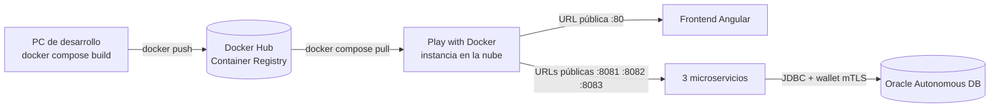

# Despliegue en la nube con Docker

El despliegue sigue el flujo de la guía de la semana 5:

1. Construir las imágenes.
2. Publicarlas en un **Container Registry** (Docker Hub).
3. Ejecutarlas en una instancia de Docker en la nube (**Play with Docker**) para obtener **URLs públicas**.



## 1. Publicar las imágenes en Docker Hub (desde el PC)

Requisito: una cuenta en [hub.docker.com](https://hub.docker.com) y Docker Desktop.

```powershell
docker login
.\scripts\publicar-imagenes.ps1 -Usuario TU_USUARIO -Version 1.0.0
```

Se publican 4 imágenes, cada una con las etiquetas `1.0.0` y `latest`:

| Imagen | Puerto | Contenido |
|---|---|---|
| `TU_USUARIO/agora-ms-usuarios` | 8081 | Microservicio de usuarios (JRE 21) |
| `TU_USUARIO/agora-ms-foro` | 8082 | Microservicio del foro |
| `TU_USUARIO/agora-ms-moderacion` | 8083 | Microservicio de moderación |
| `TU_USUARIO/agora-frontend` | 80 | Angular compilado servido con nginx |

Las imágenes **no contienen credenciales**: el wallet y la contraseña de Oracle se entregan al momento de ejecutar (volumen y `.env`).

## 2. Ejecutar en Play with Docker

1. Entra a [labs.play-with-docker.com](https://labs.play-with-docker.com), inicia sesión con tu cuenta de Docker Hub y presiona **Start**.
2. Presiona **+ ADD NEW INSTANCE**. Se abre una terminal Linux con Docker. La sesión dura 4 horas.
3. Prepara la carpeta y descarga el compose de la nube desde GitHub:

   ```bash
   mkdir agora && cd agora
   curl -fsSLO https://raw.githubusercontent.com/rodolfoulloa/FS3_Exp2_S5_ForoEnLinea/main/docker-compose.cloud.yml
   ```

4. Crea el `.env`. Reemplaza la contraseña y el usuario de Docker Hub:

   ```bash
   cat > .env <<'FIN'
   DB_SERVICE=fs3db_tp
   DB_USER=ADMIN
   DB_PASSWORD=tu_clave
   DOCKERHUB_USER=TU_USUARIO
   VERSION=1.0.0
   FIN
   ```

5. Sube el wallet: **arrastra `Wallet_FS3DB.zip` sobre la terminal** de Play with Docker. El archivo queda en la carpeta actual; verifica con `ls`. Luego descomprímelo en `wallet/`:

   ```bash
   unzip -o Wallet_FS3DB.zip -d wallet && ls wallet
   ```

6. Descarga las imágenes y levanta todo:

   ```bash
   docker compose -f docker-compose.cloud.yml up -d
   docker compose -f docker-compose.cloud.yml ps
   docker compose -f docker-compose.cloud.yml logs ms-usuarios | grep -E "Database version|Started"
   ```

7. Arriba de la terminal aparecen los puertos publicados como enlaces: **80**, **8081**, **8082** y **8083**. Cada uno es una URL pública con este formato:

   `http://ipXXX-XX-X-XX-<sesión>-8081.direct.labs.play-with-docker.com`

## 3. Probar con las URLs públicas

- **Frontend:** abre el enlace del puerto **80**.
- **Backend con Postman:** importa `postman/agora-nube.postman_environment.json`, reemplaza las 3 URLs (`usuariosUrl`, `foroUrl` y `moderacionUrl`) por las de los puertos 8081, 8082 y 8083, elige el entorno **Ágora · Nube** y ejecuta las colecciones de los 3 microservicios.
- **Conexión con Oracle:** `GET {{usuariosUrl}}/actuator/health` responde `UP`. Al crear un registro desde Postman, aparece en Oracle (Database Actions → SQL: `SELECT * FROM FORO_TEMAS ORDER BY ID DESC`).

## Problemas frecuentes

| Síntoma | Causa y solución |
|---|---|
| `ORA-12506` o `IO Error` al arrancar un microservicio | El wallet no está en `./wallet` o falta `DB_SERVICE`. Revisa `ls wallet` y el `.env` |
| Un contenedor se reinicia por memoria | La instancia es pequeña. El compose de la nube ya limita Java (`-Xmx256m`). Si persiste, levanta los servicios de a uno |
| `ms-foro` o `ms-moderacion` responden 503 | Todavía no termina de arrancar `ms-usuarios` o `ms-foro`. Espera unos segundos (`docker compose logs -f`) |
| La sesión terminó | Play with Docker borra la instancia a las 4 horas. Repite los pasos 2 a 6: las imágenes ya están en Docker Hub |
