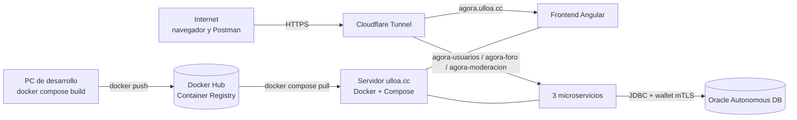

# Despliegue en la nube con Docker

El despliegue sigue el flujo de la guía de la semana 5:

1. Construir las imágenes.
2. Publicarlas en un **Container Registry** (Docker Hub).
3. Ejecutarlas en un servidor con Docker en la nube para obtener **URLs públicas**.

> **¿Por qué no Play with Docker?** La guía del curso usa [Play with Docker](https://labs.play-with-docker.com), pero el servicio fue dado de baja el **1 de marzo de 2026**. Ágora se despliega en un servidor propio con Docker publicado en internet bajo el dominio **ulloa.cc**, con HTTPS de Cloudflare. A diferencia de Play with Docker, cuyas sesiones duraban 4 horas, las URLs quedan disponibles de forma permanente.

## URLs públicas

| Componente | URL pública | Puerto interno del servidor |
|---|---|---|
| Frontend Angular | **https://agora.ulloa.cc** | 4104 → 80 |
| ms-usuarios | **https://agora-usuarios.ulloa.cc** | 4101 → 8081 |
| ms-foro | **https://agora-foro.ulloa.cc** | 4102 → 8082 |
| ms-moderacion | **https://agora-moderacion.ulloa.cc** | 4103 → 8083 |



## 1. Publicar las imágenes en Docker Hub (desde el PC)

> Ya publicadas en **https://hub.docker.com/u/rodolfoulloa** (`agora-ms-usuarios`, `agora-ms-foro`, `agora-ms-moderacion` y `agora-frontend`, etiquetas `1.0.0` y `latest`), todas públicas.

Requisito: una cuenta en [hub.docker.com](https://hub.docker.com) y Docker Desktop.

```powershell
docker login
powershell -ExecutionPolicy Bypass -File .\scripts\publicar-imagenes.ps1 -Usuario rodolfoulloa -Version 1.0.0
```

`-ExecutionPolicy Bypass` permite ejecutar el script solo en esa llamada, sin cambiar la política de ejecución de Windows. Sin esa opción, PowerShell responde *"la ejecución de scripts está deshabilitada en este sistema"*.

Se publican 4 imágenes, cada una con las etiquetas `1.0.0` y `latest`:

| Imagen | Puerto | Contenido |
|---|---|---|
| `rodolfoulloa/agora-ms-usuarios` | 8081 | Microservicio de usuarios (JRE 21) |
| `rodolfoulloa/agora-ms-foro` | 8082 | Microservicio del foro |
| `rodolfoulloa/agora-ms-moderacion` | 8083 | Microservicio de moderación |
| `rodolfoulloa/agora-frontend` | 80 | Angular compilado servido con nginx |

Las imágenes **no contienen credenciales**: el wallet y la contraseña de Oracle se entregan al momento de ejecutar (volumen y `.env`).

## 2. Ejecutar en el servidor

El servidor (Debian 13, x86_64) solo necesita Docker con Compose. En la carpeta `~/agora` hay 3 cosas, y **ninguna se compila ahí**:

| Archivo | Contenido |
|---|---|
| `docker-compose.yml` | Copia de [`docker-compose.cloud.yml`](../docker-compose.cloud.yml) |
| `.env` | Credenciales de Oracle y puertos (permisos `600`, no se sube a Git) |
| `wallet/` | Wallet de Oracle (permisos `600`, no se sube a Git) |

1. Copia los archivos desde el PC (por SSH):

   ```powershell
   ssh ullo1 "mkdir -p ~/agora/wallet"
   scp docker-compose.cloud.yml ullo1:agora/docker-compose.yml
   scp wallet/* ullo1:agora/wallet/
   ```

2. Crea el `.env` en el servidor. Los puertos se publican **solo en `127.0.0.1`**, porque en el servidor ya hay otros servicios en 8081 a 8083 y el acceso desde internet pasa únicamente por Cloudflare:

   ```bash
   cat > ~/agora/.env <<'FIN'
   DB_SERVICE=fs3db_tp
   DB_USER=ADMIN
   DB_PASSWORD=tu_clave
   DOCKERHUB_USER=rodolfoulloa
   VERSION=1.0.0
   BIND=127.0.0.1
   PUERTO_USUARIOS=4101
   PUERTO_FORO=4102
   PUERTO_MODERACION=4103
   PUERTO_FRONTEND=4104
   FIN
   chmod 600 ~/agora/.env
   ```

3. Descarga las imágenes de Docker Hub y levanta todo:

   ```bash
   cd ~/agora
   docker compose pull
   docker compose up -d
   docker compose ps
   docker compose logs ms-usuarios | grep -E "Database version|Started"
   ```

4. Publica los 4 subdominios en el túnel de Cloudflare (`/etc/cloudflared/config.yml`, antes de la regla final `http_status:404`) y crea sus registros DNS:

   ```yaml
     - hostname: agora.ulloa.cc
       service: http://localhost:4104
     - hostname: agora-usuarios.ulloa.cc
       service: http://localhost:4101
     - hostname: agora-foro.ulloa.cc
       service: http://localhost:4102
     - hostname: agora-moderacion.ulloa.cc
       service: http://localhost:4103
   ```

   ```bash
   sudo cloudflared tunnel ingress validate
   sudo systemctl restart cloudflared
   sudo cloudflared tunnel route dns <id-del-túnel> agora.ulloa.cc   # y los otros 3
   ```

Los contenedores usan `restart: unless-stopped`: vuelven a levantarse solos si el servidor se reinicia. Cada microservicio tiene un límite de 512 MB (`mem_limit` y `-Xmx256m`), para no afectar a los demás servicios del servidor, y usa como máximo 3 conexiones a Oracle, porque la base Always Free admite unas 30 sesiones en total.

## 3. Probar con las URLs públicas

- **Frontend:** abre **https://agora.ulloa.cc**.
- **Salud de los microservicios:** `https://agora-usuarios.ulloa.cc/actuator/health` (y lo mismo en `agora-foro` y `agora-moderacion`) responde `{"status":"UP"}`.
- **Backend con Postman:** importa `postman/agora-nube.postman_environment.json` (ya trae las 3 URLs), elige el entorno **Ágora · Nube** y ejecuta las colecciones de los 3 microservicios. También se pueden ejecutar con Newman:

  ```powershell
  npx newman run ms-usuarios\postman\ms-usuarios.postman_collection.json -e postman\agora-nube.postman_environment.json
  ```

- **Resultado:** las 3 colecciones pasan contra la nube: 111 solicitudes y 189 aserciones, sin fallas.
- **Conexión con Oracle:** al crear un registro desde Postman, aparece en Oracle (Database Actions → SQL: `SELECT * FROM FORO_TEMAS ORDER BY ID DESC`).

## Problemas frecuentes

| Síntoma | Causa y solución |
|---|---|
| `ORA-12506` o `IO Error` al arrancar un microservicio | El wallet no está en `./wallet` o falta `DB_SERVICE`. Revisa `ls wallet` y el `.env` |
| `ORA-03113: database connection closed by peer` desde todos lados, y Database Actions responde *HTTP 571* | Se agotaron las sesiones de la base Always Free (unas 30 en total). Cada microservicio abre un pool de conexiones; si quedan contenedores corriendo en otro equipo (por ejemplo, el `docker compose` local), copan la base. Ambos compose limitan el pool a 3 conexiones (`SPRING_DATASOURCE_HIKARI_MAXIMUM_POOL_SIZE`). Detén los contenedores que no uses y, si la base no se recupera, reiníciala (**More actions → Restart**) |
| `ms-foro` o `ms-moderacion` responden 503 | Todavía no termina de arrancar `ms-usuarios` o `ms-foro`. Espera unos segundos (`docker compose logs -f`) |
| Una URL responde 502 | El contenedor de ese subdominio está detenido o reiniciándose: `docker compose ps` |
| `ERR_NAME_NOT_RESOLVED` en un PC, pero funciona en otro dispositivo | Caché de DNS negativa del PC o de su DNS (por ejemplo Quad9 o Google). `ipconfig /flushdns`, o espera unos minutos a que expire |
